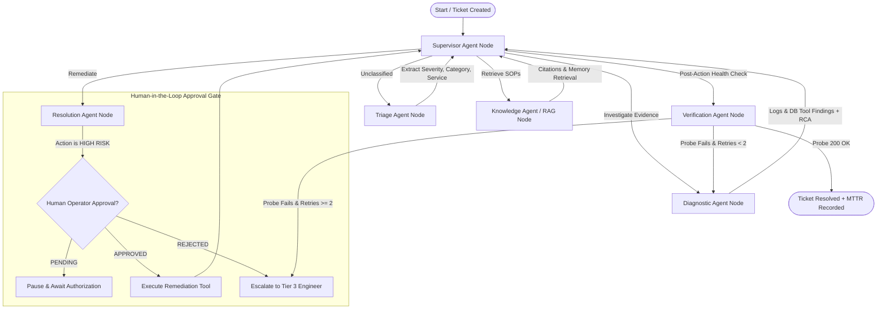

# AegisOps: Autonomous IT Support & Operations Agent

[](https://www.python.org/)
[](https://github.com/langchain-ai/langgraph)
[](https://fastapi.tiangolo.com/)
[](https://react.dev/)
[-black.svg)](https://ollama.com/)
[]()

> An enterprise-grade, autonomous Site Reliability Engineering (SRE) and IT Support platform powered by **LangGraph** multi-agent orchestration and local **Ollama** models. Automatically classifies tickets, executes RAG against internal runbooks, analyzes live system logs, performs root-cause diagnostics, guards risky remediations with **Human-in-the-Loop (HITL)** approval gates, and reflects on synthetic verification probes.

---

## 🎯 Problem Statement & Real-World Scenario

In modern engineering organizations, whenever services fail, employees and alerts raise tickets. Engineers spend hours manually checking logs, reading runbooks, diagnosing root causes, and executing commands.

### The Real-World Scenario:
1. **Employee Reports**: *"My application is returning HTTP 500 errors. I cannot access the application."*
2. **Autonomous Agent Workflow**:
   - **Triage Agent**: Understands and classifies the incident as `P1_CRITICAL` `APPLICATION` issue impacting `api-gateway`.
   - **Knowledge Agent**: Executes **RAG** against internal SOPs (`SOP-201: Troubleshooting HTTP 500 in API Gateway`), retrieving exact remediation procedures with source citations.
   - **Diagnostic Agent**: Gathers application logs, detects worker thread deadlock and socket exhaustion, and formulates root-cause reasoning.
   - **Resolution Agent**: Proposes `execute_service_restart(service_name='api-gateway')`. Evaluates action risk score: **HIGH RISK** (causes temporary 5-10s packet drop).
   - **Human-in-the-Loop Gate**: Checkpoints LangGraph state, pauses autonomous execution, and surfaces an interactive authorization card to the on-call engineer.
   - **Operator Approves**: Engineer clicks **"Authorize & Execute Remediation"**.
   - **Remediation Execution**: The agent safely restarts the microservice worker pool.
   - **Verification Agent (Reflection)**: Executes synthetic HTTP health probes (`GET /healthz`). Confirms `200 OK`, latency `< 35ms`, and closes ticket with full resolution summary and MTTR.

---

## 🧠 LangGraph Architecture



### Specialized Agents:
| Node | Responsibility |
| :--- | :--- |
| **Supervisor Agent** | Evaluates workflow state and orchestrates next specialized node. |
| **Triage Agent** | Analyzes complaint, categorizes domain (App, DB, Auth), assigns severity (P1-P4). |
| **Knowledge Agent (RAG)** | Retrieves internal runbooks, SOPs, and past incidents with similarity scores and citations. |
| **Diagnostic Agent** | Investigates live microservice logs, database pools, and synthesizes root causes. |
| **Resolution Agent** | Determines remediation action. Enforces Human-in-the-Loop approval for risky actions. |
| **Verification Agent** | Reflects on outcomes using synthetic health probes. Retries or marks resolved. |

---

## 🛠️ 100% Free & Local Technology Stack

No paid cloud subscriptions or proprietary API keys required:
- **LLM Orchestration**: **LangGraph** (StateGraph with checkpointers)
- **Local LLM**: **Ollama** (`llama3.2`, `llama3`, `mistral`, `qwen2.5`) with built-in heuristic reasoning fallback
- **Backend**: **FastAPI** (Python 3.11) with async background processing
- **Database & Storage**: **SQLite** (instant zero-config) + **PostgreSQL & pgvector** (Docker supported)
- **RAG Engine**: Vector cosine semantic search with source citations & multi-format support (`.pdf`, `.docx`, `.md`, `.txt`)
- **Frontend**: **React 18** + **Vite** + **Tailwind CSS** + **Lucide Icons**
- **Deployment**: **Docker Compose** + `start.sh`

---

## 🚀 Quickstart Guide

### 1. Prerequisites
- Python 3.11+
- Node.js 18+
- (Optional) [Ollama](https://ollama.com/) for local LLM inference

### 2. Run with One Command
```bash
# Clone and enter directory
cd chatbot-agent

# Start both Backend & Frontend
./start.sh
```

- **Frontend Command Center**: [http://localhost:5173](http://localhost:5173)
- **FastAPI Interactive Docs**: [http://localhost:8000/docs](http://localhost:8000/docs)

### 3. (Optional) Run with Ollama Local LLM
If you have Ollama installed:
```bash
ollama serve
ollama pull llama3.2
```
*Note: If Ollama is not currently active, the application automatically uses its built-in expert reasoning engine so all features, agent steps, RAG, and Human-in-the-Loop gates work seamlessly out of the box!*

---

## 🧪 Running the Test Suite

Run the full end-to-end multi-agent test suite:
```bash
PYTHONPATH=backend ./venv/bin/pytest backend/tests/
```
Output:
```
backend/tests/test_agent_workflow.py .                                   [ 50%]
backend/tests/test_db_scenario.py .                                      [100%]
============================== 2 passed in 0.67s ===============================
```

---

## 🌟 What Makes This a Genuine Agentic Project?

1. **Planning**: Supervisor Agent dynamically inspects milestones and plans next steps.
2. **Reasoning**: Synthesizes stack traces, error counts, and CPU metrics to uncover root causes.
3. **Tool Calling**: Invokes `query_application_logs`, `query_db_diagnostics`, `execute_service_restart`, and `probe_service_health`.
4. **RAG with Citations**: Semantic chunking and vector retrieval over troubleshooting runbooks.
5. **Human-in-the-Loop**: Halts execution when risk threshold is exceeded and prompts for human authorization.
6. **Reflection & Self-Correction**: The Verification Agent validates whether the remediation actually fixed the outage. If probes fail, it loops back for secondary diagnosis.
7. **Short & Long-Term Memory**: Recalls previously resolved incidents to accelerate MTTR.
8. **Interactive Chaos Simulator**: Includes a live mock microservice cluster (`api-gateway`, `order-db`, `auth-service`) with 1-click failure injections.

---

## 📂 Project Structure

```
chatbot-agent/
├── backend/
│   ├── app/
│   │   ├── agent/                 # LangGraph Multi-Agent Engine
│   │   │   ├── graph.py           # StateGraph definition & edges
│   │   │   ├── state.py           # ITSupportState TypedDict
│   │   │   ├── supervisor.py      # Supervisor routing logic
│   │   │   ├── triage.py          # Triage Agent node
│   │   │   ├── knowledge.py       # Knowledge / RAG Agent node
│   │   │   ├── diagnostic.py      # Diagnostic Agent node
│   │   │   ├── resolution.py      # Resolution Agent node (HITL gate)
│   │   │   ├── verification.py    # Verification & Reflection node
│   │   │   ├── llm_factory.py     # Ollama local LLM client + fallback
│   │   │   ├── tools/             # Diagnostic & Remediation tools
│   │   │   └── memory/            # Short & Long-term memory store
│   │   ├── api/                   # FastAPI Endpoints
│   │   │   ├── incidents.py       # Ticket lifecycle & approval routes
│   │   │   ├── knowledge.py       # RAG document ingestion & search
│   │   │   ├── infra.py           # Chaos simulator & metrics
│   │   │   └── analytics.py       # MTTR and evaluation metrics
│   │   ├── models/                # SQLAlchemy models
│   │   ├── schemas/               # Pydantic schemas
│   │   └── services/              # Infra simulator, RAG engine, Seeding
│   ├── requirements.txt
│   └── tests/                     # Multi-Agent Integration Tests
├── frontend/                      # React 18 Ops Command Center
│   ├── src/
│   │   ├── components/            # IncidentList, Studio, Infra, Knowledge
│   │   ├── api/client.js          # API Client
│   │   └── App.jsx
│   ├── package.json
│   └── vite.config.js
├── runbooks/                      # Realistic IT Runbooks & SOPs
├── docker-compose.yml             # Docker orchestration
├── start.sh                       # One-click startup script
└── README.md
```
